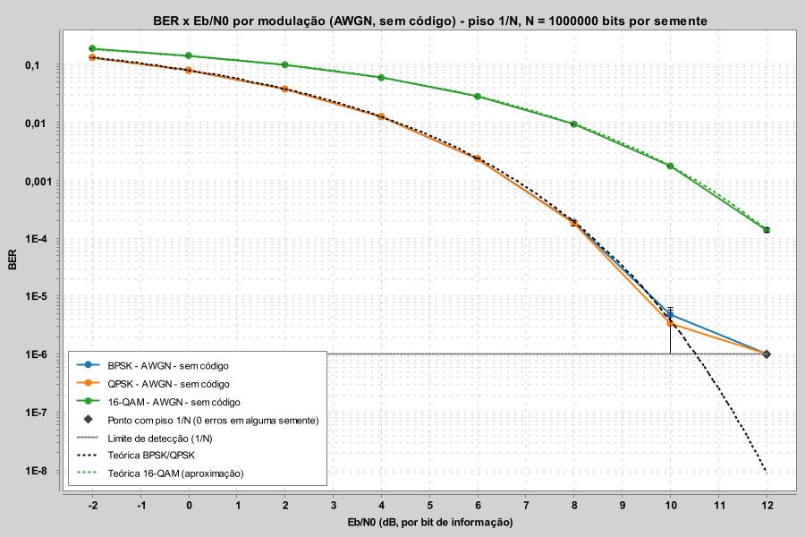
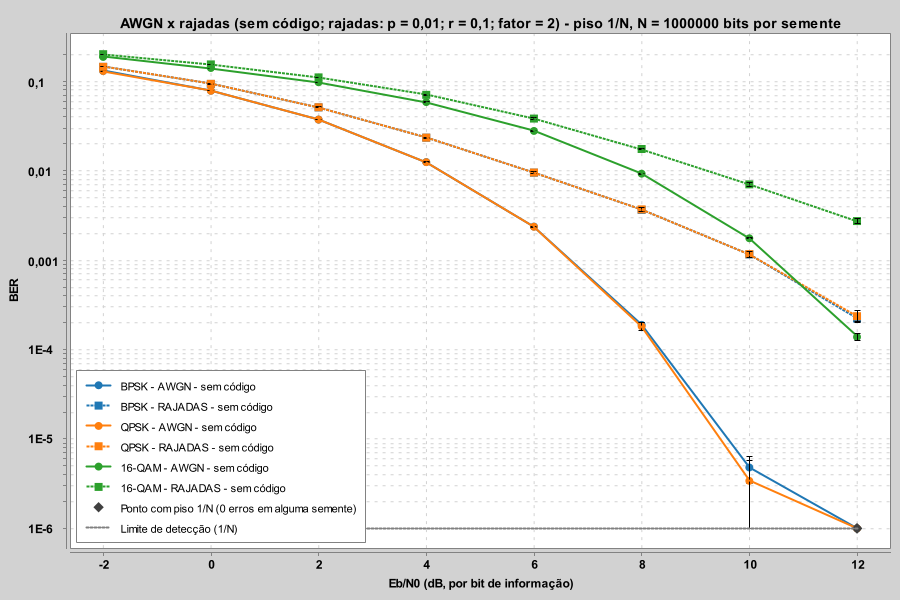
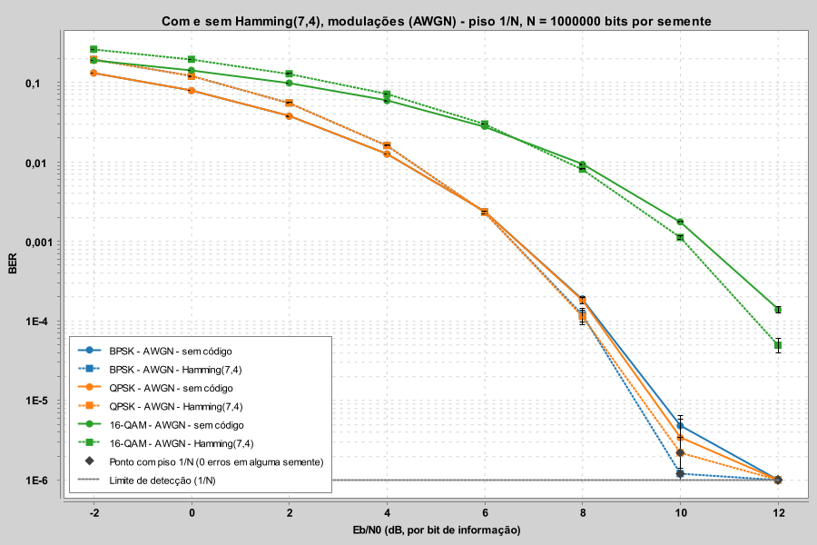
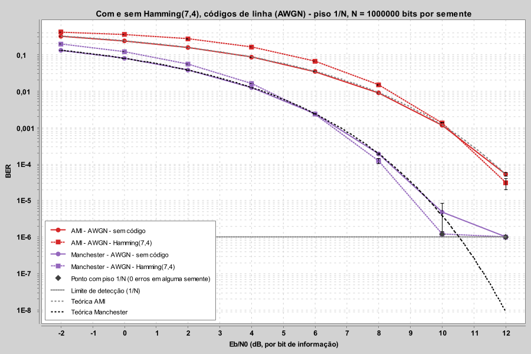

# Simulador de Transmissão Digital

Trabalho do Grau B de Redes de Computadores (Unisinos, 2026). Simulador em Java de uma
cadeia de transmissão digital completa: codificação de canal (Hamming 7,4),
codificação de linha (AMI e Manchester), modulação digital (BPSK, QPSK e 16-QAM),
canais AWGN e de rajadas (Gilbert-Elliott) e medição da taxa de erro de bit (BER),
com validação contra as curvas teóricas.

## Vídeo de execução

- Youtube: https://youtu.be/GYBoMDU2e8E

## Requisitos

- Java 23 (testado com Amazon Corretto 23.0.2)
- Maven 3.9 ou superior
- Bash para o script de reprodução (no Windows, use o Git Bash)

## Instalação

```bash
git clone https://github.com/JGui-Fernandes/simulador-transmissao-digital.git
cd simulador-transmissao-digital
mvn clean package
```

O `mvn clean package` compila o projeto, roda todos os testes e gera o jar executável
`target/gb.jar`, com as dependências incluídas.

## Execução

### Testes

```bash
mvn test
```

### Uma transmissão pela linha de comando

```bash
java -jar target/gb.jar --mensagem "Redes" --modo MODULADO --modulacao QAM16 --ebn0 10 --canal AWGN --semente 42
```

A saída mostra o texto recebido, a BER, o número de bits errados e as posições dos
bits errados. Use `java -jar target/gb.jar --help` para ver todas as opções
(modo, código de linha, modulação, Hamming, canal, Eb/N0, semente e parâmetros
das rajadas).

### Reproduzir todos os resultados com um único comando

```bash
bash scripts/executar_tudo.sh
```

O script, a partir de uma cópia limpa do repositório:

1. compila o projeto (`mvn clean package`);
2. roda o experimento completo (800 execuções) com `config/experimento_base.properties`;
3. confere o CSV e grava `resultados/brutos/experimento_base.csv`;
4. gera as figuras em `docs/figuras/`;
5. gera a tabela de compromisso em `docs/tabela_compromisso.md`.

O log de cada execução fica em `resultados/logs/`. O experimento completo leva cerca
de 4 minutos. Como todas as execuções usam sementes fixas, rodar de novo produz
exatamente o mesmo CSV.

Se o `mvn` não estiver no PATH, gere o jar pelo painel Maven do IntelliJ
(Lifecycle → package) e rode `PULAR_BUILD=1 bash scripts/executar_tudo.sh`.

Para um teste rápido (32 execuções, menos de 1 segundo), sem sobrescrever os
resultados oficiais:

```bash
ESPERADO=33 CONFIG=config/experimento_teste.properties SAIDA=resultados/teste/teste.csv bash scripts/executar_tudo.sh
```

## Parâmetros

| Parâmetro | Valor |
|---|---|
| Eb/N0 | −2 a 12 dB, passo de 2 dB (8 valores) |
| Bits por execução | 1.000.000 |
| Sementes | 1, 2, 3, 4 e 5 (IC 95% pela distribuição t) |
| Esquemas | BPSK, QPSK, 16-QAM, AMI, Manchester |
| Canais | AWGN e rajadas (p = 0,01; r = 0,1; fator = 2) |
| Código de canal | nenhum e Hamming(7,4) |

Convenções, justificativas e escolha do fator das rajadas em
[docs/parametros.md](docs/parametros.md). Plano e execução do experimento em
[docs/experimento_final.md](docs/experimento_final.md).

## Arquitetura

Cadeia de transmissão, fluxo dos experimentos, pacotes e decisões de projeto em
[docs/arquitetura.md](docs/arquitetura.md).

## Resultados

| | |
|---|---|
|  |  |
|  |  |

Principais conclusões:

- Em AWGN sem código, a simulação ficou a no máximo 0,1 dB da teoria em todos os esquemas.
- O QPSK tem a mesma BER por bit do BPSK com o dobro da eficiência; o 16-QAM exige 3,7 dB a mais para BER 10⁻³.
- O AMI ocupa metade da banda do Manchester, mas precisa de 3,4 dB a mais.
- O canal de rajadas custa ≈ 3,5 dB em BER 10⁻³ e anula o ganho do Hamming(7,4).

Documentos:

- Tabela de compromisso: [docs/tabela_compromisso.md](docs/tabela_compromisso.md)
- Análise e discussão: [docs/discussão.md](docs/discuss%C3%A3o.md)

## Estrutura do repositório

```
config/               configurações dos experimentos (.properties)
docs/                 arquitetura, parâmetros, discussão, tabela, checklist e figuras
resultados/brutos/    CSV do experimento final e cópia da configuração usada
resultados/logs/      logs das execuções do script
scripts/              executar_tudo.sh, gerar_graficos.sh e verificar_piloto.sh
src/main/java/        código-fonte (pacote br.unisinos.edu)
src/test/java/        testes (JUnit 5)
```
