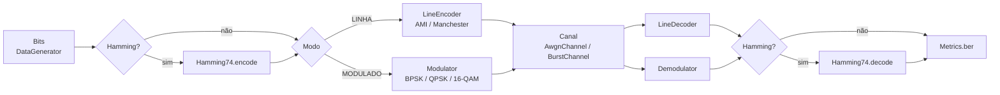
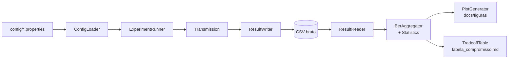

# Arquitetura

O simulador transmite uma sequência de bits por uma cadeia digital completa e mede a
taxa de erro de bit (BER). A mesma cadeia é usada pela linha de comando (CLI) e pelos
experimentos.

## Cadeia de transmissão

A classe `Transmission` encadeia todas as etapas a partir de uma `ConfigTransmission`
e devolve um `TransmissionResult`. O `SnrConverter` converte o Eb/N0 pedido no desvio
padrão σ do ruído, considerando os bits por símbolo (k), a taxa do código (R) e a
energia por bit de cada código de linha.

## Fluxo dos experimentos

O CSV bruto tem uma linha por execução. As figuras e a tabela de compromisso são
geradas só a partir dele, sem rodar simulações de novo. O `scripts/executar_tudo.sh`
executa o fluxo inteiro.

## Pacotes (`br.unisinos.edu`)

| Pacote | Responsabilidade | Classes principais |
|---|---|---|
| `mensagem` | Geração e conversão de bits | `DataGenerator` |
| `codificacao.linha` | Codificação de linha (banda base) | `LineCode`, `LineEncoder`, `LineDecoder` |
| `codificacao.canal` | Codificação de canal | `ChannelEncoder`, `ChannelDecoder`, `Hamming74` |
| `modulacao` | Modulação digital e números complexos | `Complex`, `Modulation`, `Modulator`, `Demodulator` |
| `canal` | Modelos de canal e conversão de SNR | `Channel`, `AwgnChannel`, `BurstChannel`, `SnrConverter` |
| `metricas` | BER e curvas teóricas | `Metrics`, `TheoreticalCurves` |
| `transmissao` | Pipeline completo | `Transmission`, `ConfigTransmission`, `TransmissionResult`, `Mode`, `ChannelType` |
| `cli` | Linha de comando | `Cli`, chamada pelo `Main` |
| `experimento` | Execução dos experimentos e estatística | `ConfigLoader`, `ExperimentoConfig`, `ExperimentRunner`, `ResultWriter`, `Statistics` |
| `graficos` | Leitura do CSV, figuras e tabela | `ResultReader`, `BerAggregator`, `PlotGenerator`, `TradeoffTable` |

## Decisões de projeto

- **Representação única do sinal:** todo sinal é um vetor de `Complex`. Na banda base
  só a parte real é usada; na passa-banda, os componentes I e Q.
- **Canal como interface:** `Channel.apply(sinal, σ, rnd)` permite trocar o AWGN pelo
  canal de rajadas sem mudar o restante da cadeia. O canal nunca altera o vetor de
  entrada; devolve um novo.
- **Estado das rajadas:** o `BurstChannel` mantém o estado da cadeia de Markov entre
  chamadas. O `Transmission` cria um canal novo a cada execução, para que as
  execuções sejam independentes.
- **Reprodutibilidade:** toda aleatoriedade vem de `Random` com semente explícita. Os
  dados usam a semente do experimento e o ruído usa a semente + 1000, para que os dois
  fluxos não fiquem correlacionados. As mesmas sementes geram CSVs idênticos.
- **Eb/N0 por bit de informação:** com Hamming, a taxa R = 4/7 entra no cálculo do σ,
  para que esquemas com e sem código sejam comparados com a mesma energia por bit
  de informação.
- **Padding:** quando a mensagem não completa um bloco do Hamming ou um símbolo da
  modulação, o último bloco é completado com zeros. O tamanho original é passado ao
  decodificador, que descarta esses zeros.
- **Validação antes dos experimentos:** NRZ polar, BPSK e QPSK são testados contra as
  curvas teóricas (tolerância de ±15%) antes de qualquer experimento.
- **Piso 1/N:** execuções sem erros entram na média com BER = 1/N, e os pontos que
  dependem disso são marcados nas figuras.
